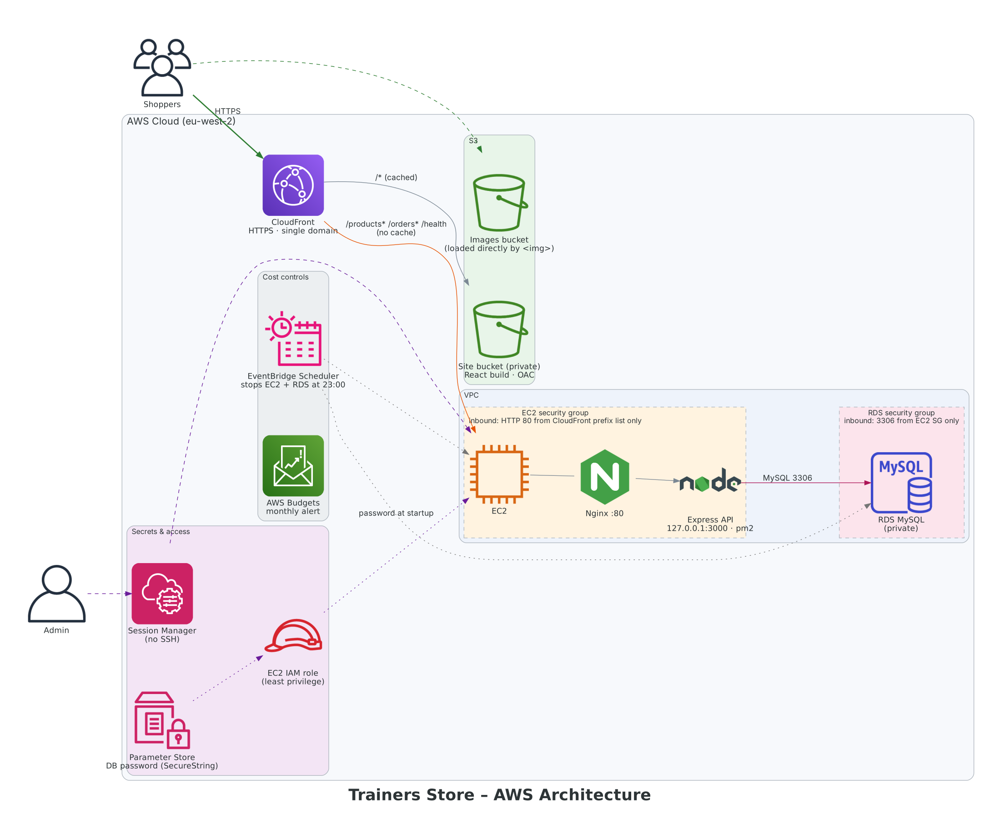

# Trainers Store: 3-tier AWS web app

A small e-commerce store (browse trainers, view details, cart, checkout) built to practise the AWS Solutions Architect Associate skills: **secure networking, a private database, CDN delivery, least-privilege IAM and cost control**.

> Backend: this repo (Node.js + Express). Frontend: React + Vite (`trainers-frontend`).
> In-depth notes, interview Q&A and a quiz: [`LESSONS.md`](LESSONS.md)

---

## Architecture



```
                        HTTPS (CloudFront default certificate)
  User ──────────────► CloudFront ─┬─ /*                      ──► S3 site bucket (private, OAC)
                                   │                                 React build: index.html + assets
                                   └─ /products*  /orders*  /health ──► EC2  (HTTP :80)
                                                                         │ Nginx :80  (only public port, CloudFront-only)
                                                                         │  └► Node/Express 127.0.0.1:3000 (pm2)
                                                                         │ IAM role ──► SSM Parameter Store (DB password)
                                                                         ▼
                                                              RDS MySQL (private, 3306 from EC2 SG only)

  Product images:  loads straight from the S3 images bucket (dhrey-store-v3)
```

| Layer | Service | Notes |
|---|---|---|
| CDN / entry point | **CloudFront** | One HTTPS domain for site + API, so no CORS and no IP in the frontend |
| Static site | **S3** (private) | Read only by CloudFront via **Origin Access Control** |
| Images | **S3** | Image URLs stored in RDS |
| App | **EC2** + Nginx + Node/Express + pm2 | Node bound to localhost; Nginx reverse proxy |
| Data | **RDS MySQL** (`db.t4g.micro`, Single-AZ) | Not publicly accessible |
| Secrets | **SSM Parameter Store** (SecureString) | Read at startup via the EC2 **IAM role** |
| Admin access | **SSM Session Manager** | No SSH port open |
| Cost guardrails | **AWS Budgets**, **EventBridge Scheduler** | Alert + nightly stop |

---

## Design decisions

### Security (defence in depth)
- **Single public entry:** EC2 port 80 accepts traffic only from CloudFront's managed prefix list `com.amazonaws.global.cloudfront.origin-facing`. Nothing else is open, not even SSH (Session Manager instead).
- **Two independent locks on the app port:** no security group rule for 3000 **and** Node listens on `127.0.0.1` only.
- **Private database:** RDS `Public access = No`; port 3306 allowed only from the EC2 security group (SG referencing, not IPs).
- **Private site bucket:** no public bucket policy; CloudFront reads it via OAC.
- **No secrets in code or git:** DB password in Parameter Store, fetched with the instance role (`ssm:GetParameter` + `kms:Decrypt` on one parameter).
- **App level:** parameterised SQL (no injection), admin key on `POST /products`, rate limiting (300 req / 15 min / IP), 100 KB body limit, `x-powered-by` off.
- **Correct checkout:** a transaction with `SELECT … FOR UPDATE` row locks, so no overselling under concurrent orders.

### Cost (~$3–5/month when used a few hours a week)
- Cost Explorer showed RDS was **already right-sized**; the cost came from **running 24/7**. So the fix is uptime, not instance size.
- **Stop when idle** (`scripts/aws-stop.sh`) plus an **EventBridge Scheduler** nightly stop. This also catches RDS's **automatic restart after 7 days** stopped.
- **No Elastic IP:** an EIP is billed while the instance is stopped; the auto-assigned IPv4 is released (free) when stopped. The changing address is handled by `scripts/aws-start.sh`, which re-points the CloudFront origin.
- Breaks longer than a week: **snapshot → delete → restore** with the same identifier (same endpoint).
- CloudFront and Parameter Store standard parameters fit in the free tier; **Budgets** alert as a safety net.

### Trade-offs / what I'd do for production
| Now (demo) | Production |
|---|---|
| Single EC2 | ALB + Auto Scaling group across 2 AZs |
| RDS Single-AZ | Multi-AZ, automated backups 7+ days |
| CloudFront → EC2 over HTTP | HTTPS to origin (ACM certificate on ALB) |
| Parameter Store | Secrets Manager with automatic rotation |
| Manual console setup | Infrastructure as Code (CloudFormation / Terraform) |
| Manual deploys | CI/CD (GitHub Actions → S3 + EC2/CodeDeploy) |
| Basic logs | CloudWatch Logs + alarms, AWS WAF on CloudFront |

---

## API

| Method | Path | Description |
|---|---|---|
| GET | `/health` | App + DB check → `{"status":"ok","db":"ok"}` |
| GET | `/products` | List trainers |
| GET | `/products/:id` | One trainer |
| POST | `/products` | Add a trainer; header `x-admin-key` required |
| POST | `/orders` | Checkout: `{"items":[{"id":1,"quantity":2}]}`; checks and decrements stock atomically |

---

## Running it

### Backend on EC2
```bash
git clone <this repo> && cd trainers.backend
npm install
cp .env.example .env && nano .env      # RDS endpoint, user, DB_PASSWORD_PARAM, ADMIN_KEY, HOST=127.0.0.1
pm2 start server.js --name trainers && pm2 save && pm2 startup
sudo dnf install -y nginx
sudo cp deploy/nginx-trainers.conf /etc/nginx/conf.d/trainers.conf
sudo sed -i 's/ default_server//' /etc/nginx/nginx.conf
sudo nginx -t && sudo systemctl enable --now nginx
curl localhost/health
```

### Daily use (from your Mac)
```bash
cp scripts/aws.env.example scripts/aws.env && nano scripts/aws.env   # once
./scripts/aws-start.sh          # RDS → EC2 → re-point CloudFront → health check → prints site URL
./scripts/deploy-frontend.sh    # build React app → S3 → invalidate CloudFront
./scripts/aws-stop.sh           # EC2 → RDS
```
Requires AWS CLI v2 (sign in with `aws login`) and `jq` (built into recent macOS).

---

## One-time AWS setup

### 1. Site bucket (private)
S3 → Create bucket `dhrey-trainers-site` (eu-west-2) → keep **Block all public access ON**. No static website hosting needed.

### 2. CloudFront distribution
**Create distribution:**
- **Origin 1 (site):** choose the `dhrey-trainers-site` bucket → Origin access: **Origin access control settings** → create an OAC → after creating, **copy the bucket policy** CloudFront offers and paste it into the bucket's Permissions.
- **Default root object:** `index.html`
- **Viewer protocol policy:** Redirect HTTP to HTTPS
- **WAF:** optional (paid). "Do not enable" is fine for this demo.

**Add Origin 2 (API):** Origins → Create origin
- Origin domain: EC2 **Public IPv4 DNS** (e.g. `ec2-18-130-1-2.eu-west-2.compute.amazonaws.com`)
- Protocol: **HTTP only**, port 80
- **Origin ID/name: `ec2-api`** (the start script looks for this name)

**Add 3 behaviours** (Behaviors → Create behavior), each with origin `ec2-api`:

| Path pattern | Allowed methods | Cache policy | Origin request policy |
|---|---|---|---|
| `/products*` | GET, HEAD, OPTIONS, PUT, POST, PATCH, DELETE | **CachingDisabled** | **AllViewerExceptHostHeader** |
| `/orders*` | same | **CachingDisabled** | **AllViewerExceptHostHeader** |
| `/health` | GET, HEAD | **CachingDisabled** | **AllViewerExceptHostHeader** |

Caching is disabled so stock and checkout are always live.

### 3. Lock EC2 to CloudFront
EC2 security group → inbound:
- Remove `HTTP 80 from 0.0.0.0/0`
- Add `HTTP 80`, source = **prefix list `com.amazonaws.global.cloudfront.origin-facing`**
- Remove `SSH 22` once Session Manager works (step 5)

The CloudFront prefix list counts as many entries against the security group rule quota. If AWS says the limit is exceeded, put the rule in its own new security group attached to the instance.

### 4. IAM role for EC2
IAM → Roles → Create role → AWS service **EC2** → attach **AmazonSSMManagedInstanceCore** (Session Manager) → plus an inline policy:
```json
{
  "Version": "2012-10-17",
  "Statement": [
    { "Effect": "Allow", "Action": "ssm:GetParameter",
      "Resource": "arn:aws:ssm:eu-west-2:<ACCOUNT_ID>:parameter/trainersdb1/dev/db-password" },
    { "Effect": "Allow", "Action": "kms:Decrypt",
      "Resource": "*",
      "Condition": { "StringEquals": { "kms:ViaService": "ssm.eu-west-2.amazonaws.com" } } }
  ]
}
```
EC2 → instance → Actions → Security → **Modify IAM role** → select it.

### 5. Session Manager instead of SSH
With the role attached (and the SSM agent, pre-installed on Amazon Linux): EC2 → instance → **Connect → Session Manager**. Once it works, delete the SSH rule.

### 6. DB password in Parameter Store
Systems Manager → Parameter Store → Create: name `/trainersdb1/dev/db-password`, type **SecureString**, value = DB password.
On EC2, in `.env`: remove `DB_PASSWORD`, add `DB_PASSWORD_PARAM=/trainersdb1/dev/db-password` and `AWS_REGION=eu-west-2` → `pm2 restart trainers --update-env`. The log shows *"DB password loaded from Parameter Store"*.

### 7. Cost guardrails
- **Budgets:** monthly cost budget $10, alert at 80%.
- **EventBridge Scheduler:** daily 23:00 → target *RDS StopDBInstance* `{"DbInstanceIdentifier":"trainers-db1"}` (and *EC2 StopInstances*).
